<a id="readme-top"></a>

<br />
<div align="center">
  <a href="https://github.com/Kc1t/alethe-orchestrate-skill">
    
  </a>

  <h1 align="center">alethe-orchestrate</h1>

  <p align="center">
    <b>Orchestrate coding agents, and prove it was worth it.</b>
    <br />
    An agent skill that turns your coding agent into a planner: it hands bounded work to Codex,
    Claude Code, Antigravity, Kimi or any CLI agent, on the cheapest model that can do it, and
    reports what every worker did and cost.
  </p>

  <p align="center">
    <a href="https://github.com/Kc1t/alethe-orchestrate-skill/actions/workflows/ci.yml"></a>
    <a href="./CHANGELOG.md"></a>
    <a href="./LICENSE"></a>
    
    
    <a href="https://agentskills.io"></a>
  </p>

  <p align="center">
    <a href="#install">Install</a>
    ·
    <a href="#how-it-works">How it works</a>
    ·
    <a href="#call-it-once-at-any-point">Call it once</a>
    ·
    <a href="#the-report">The report</a>
    ·
    <a href="#commands">Commands</a>
    ·
    <a href="https://github.com/Kc1t/alethe-orchestrate-skill/issues/new?labels=bug">Report Bug</a>
    ·
    <a href="https://github.com/Kc1t/alethe-orchestrate-skill/issues/new?labels=enhancement">Request Feature</a>
    ·
    <a href="https://github.com/Kc1t/alethe-agents">Alethe</a>
  </p>
</div>

## What It Is

Handing a task to a second agent is easy. Knowing whether it paid off is the actual job. Every
worker loads its own CLI context before it reads a line of your code, a team of agents can spend a
day's quota in minutes, and most tools leave you guessing what the tokens bought.

**alethe-orchestrate is a skill for that.** Your agent stays the lead: it picks a playbook, splits
the work into bounded units, and sends each unit to the cheapest CLI and model that can do it. A
small runner starts the workers, enforces the limits and writes down what happened. When the work
is done, `report` tells you what each worker did, why, and what its CLI said it cost.

It is a plain [Agent Skill](https://agentskills.io): a `SKILL.md`, a few references loaded on
demand, and one Python script with no dependencies. It needs at least one agent CLI. Python 3.9
or newer is optional: without it, your agent detects the CLIs, offers you the options, starts the
workers from its own shell and writes the report itself, with soft limits instead of enforced
ones. It works on its own; inside [Alethe](https://github.com/Kc1t/alethe-agents) it can also put
workers on Alethe's orchestration board.

## Why It's Different

- **It shows what the spend bought.** The report explains what each worker did, why, where it ran,
  and the tokens and cost its CLI reported, never an estimate. Mark each result used or discarded
  and the report splits the spend between them.
- **Limits are enforced, not requested.** The runner checks budgets per wave and across the whole
  orchestration, hands Claude workers a hard `--max-budget-usd`, turns off subagents in Codex and
  Claude workers, and refuses to start an orchestration inside a worker.
- **Lean workers.** Codex and Claude workers start without your MCP servers. In a one-line check on
  the same machine, a Claude haiku worker took 38,157 tokens ($0.08) with version 12 against
  76,160 ($0.16) with version 11.
- **It checks what workers claim.** A read-only worker that changes your checkout is caught by
  comparing git before and after, and every worker ends with a status line, so blocked or doubtful
  work lands in the report's to-do list instead of passing as done.
- **It knows when not to orchestrate.** `dry-run` warns when the briefs are too small to be worth a
  worker, when a cost limit cannot see some CLIs, and when a writer would mix its diff with your
  uncommitted changes.
- **Quota-aware, Windows included.** Work moves to the next provider when one runs low, as Alethe
  reports or you say, and workers run headless without tmux on Windows, macOS and Linux.
- **Easy to audit.** Python's standard library only, no network access (a test fails if the runner
  imports a networking module) and no install scripts. The plugin's one hook prints a short
  reminder while you have orchestration on, and nothing otherwise.

<p align="center">
  <picture>
    <source media="(prefers-color-scheme: dark)" srcset="./docs/assets/drawings/savings-dark.svg">
    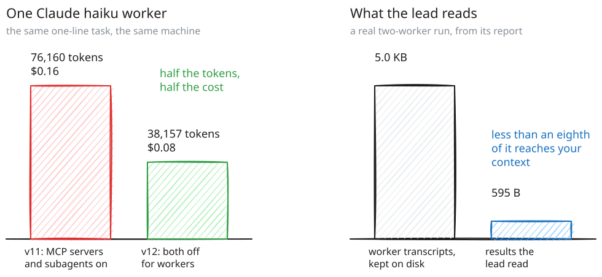
  </picture>
</p>

## Agents

| Agent | CLI | Read-only work | Writing | Resume | Reports |
|:-:|---|---|---|:-:|---|
| <br>**Claude Code** | `claude` | `plan` permission mode | `acceptEdits` | ✓ | Tokens and cost |
| 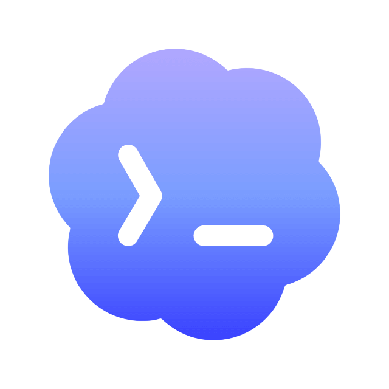<br>**Codex** | `codex` | `read-only` sandbox | `workspace-write` sandbox | ✓ | Tokens |
| <br>**Antigravity** | `agy` | `plan` mode | `accept-edits` mode | ✓ | Tokens |
| <picture><source media="(prefers-color-scheme: dark)" srcset="./docs/assets/agents/kimi-dark.svg"></picture><br>**Kimi Code** | `kimi` | Contract, checked afterwards | Prompt mode, in its own worktree | ✓ | Nothing |
| <picture><source media="(prefers-color-scheme: dark)" srcset="./docs/assets/agents/shell-dark.svg"></picture><br>**Any other CLI** | your adapter | Contract, checked afterwards | Its narrowest write flag | | Whatever its output carries |

Any agent CLI with a non-interactive mode, such as Kiro, GitHub Copilot CLI, Gemini CLI or
OpenCode, runs as a custom worker once setup has checked its `--help`. Flags that approve every tool
are refused unless you allow them for that plan. Codex and Claude workers cannot start subagents and
start without MCP servers; Kimi's prompt mode approves every tool, so automatic routing never sends
it read-only work. See [`references/providers.md`](skills/alethe-orchestrate/references/providers.md)
for the exact invocations.

## How It Works

<p align="center">
  <picture>
    <source media="(prefers-color-scheme: dark)" srcset="./docs/assets/drawings/how-it-works-dark.svg">
    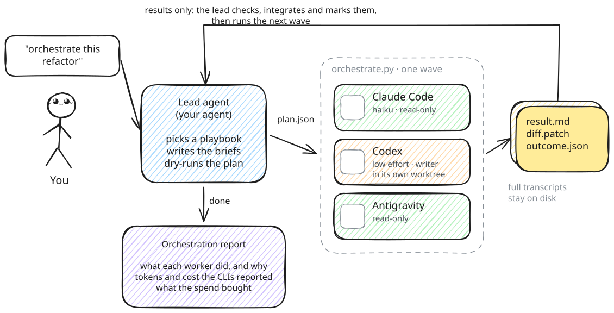
  </picture>
</p>

1. **Plan.** The lead, which is your agent, picks one of eleven playbooks and splits the task into
   units. For each unit it writes a brief: the goal as checks that pass or fail, the paths it owns,
   and what to hand back. [`references/briefs.md`](skills/alethe-orchestrate/references/briefs.md)
   scores a brief before it goes out.
2. **Preview.** `dry-run` resolves the strategy, the provider, model and effort of every worker,
   the concurrency and the budget, and warns before anything is spent. `diagram.py` can draw it.
3. **Run.** Each phase of the playbook is one wave: a batch of workers with capped concurrency,
   deadlines, budgets, and an isolated git worktree for every writer that runs alongside another.
4. **Check.** The lead reads short results and diffs, never transcripts, and treats each worker's
   status line as a claim to verify. A failed check escalates one tier, once per unit.
5. **Integrate.** The lead applies what holds up, runs the checks in the combined checkout, and
   marks each result `used`, `partial` or `discarded`.
6. **Report.** `report` explains the whole orchestration, wave by wave.

## Call It Once, at Any Point

You do not have to call it at all. Your agent picks the skill up on its own when a request is
large enough to split, and setup offers to keep it on in every project (`/alethe always`). For
one project, `/alethe on`, or any instruction that starts with "from now on", is enough. While it
is on, every prompt carries a short reminder of your goal, care level and rules, and the lead
decides per request whether to do the work itself or hand parts of it off.

<p align="center">
  <picture>
    <source media="(prefers-color-scheme: dark)" srcset="./docs/assets/drawings/stay-on-dark.svg">
    
  </picture>
</p>

It joins wherever you are, including halfway through another skill's workflow. Nothing restarts:
the spec, the task list and the diff so far become the plan, and the other workflow keeps its own
steps and gates.

<p align="center">
  <picture>
    <source media="(prefers-color-scheme: dark)" srcset="./docs/assets/drawings/mid-task-dark.svg">
    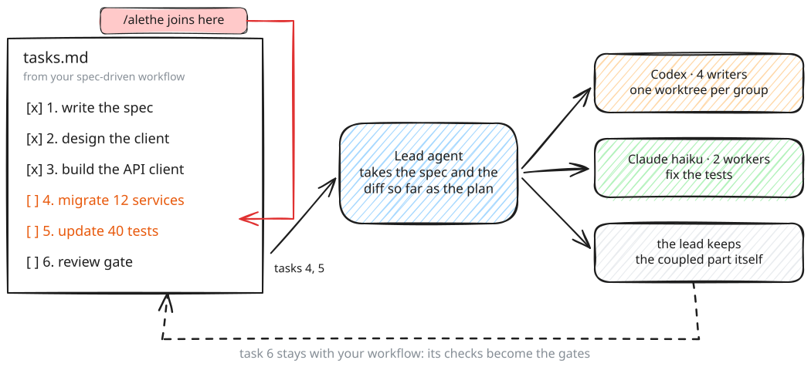
  </picture>
</p>

## Inside a Wave

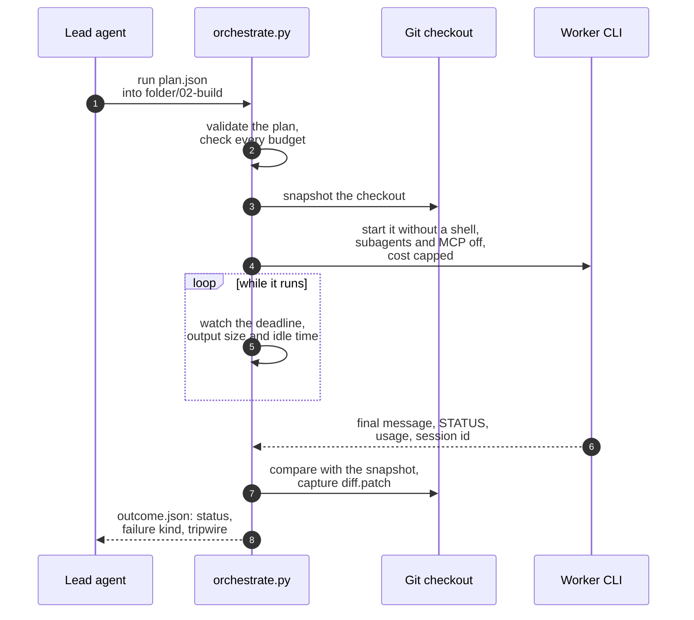

- **No shell, ever.** Workers start from argument arrays. On Windows, npm installs CLIs as `.cmd`
  shims, and cmd.exe would cut a prompt at its first newline, so the runner launches the shim's real
  target instead.
- **Budgets at the door.** A worker starts only if the wave and the orchestration still have calls,
  reported cost and reported tokens left. A Claude worker carries its share of what is left as
  `--max-budget-usd`.
- **A clock and a pulse.** Every worker has a deadline. `idleTimeoutSeconds` also stops one that
  prints nothing for too long, and `state.json` shows each running worker's output size and idle
  time.
- **A tripwire.** A read-only worker in your checkout is compared with git before and after, and a
  writer there records which files already had changes before it started.
- **Honest outcomes.** A worker succeeds only when it exits in time, its output parses and it
  returns a final answer. Each failure gets a kind, such as `rate_limited` or `auth_required`, with
  what to do next.

## Playbooks

Every playbook is a sequence of phases. A phase is either you, the lead, or a wave of workers on a
tier (`cheap`, `standard` or `strong`), with an optional gate you check before moving on.

| Playbook | Use it when | What it saves |
|---|---|---|
| `direct` | The task is narrow and clear, up to about 3 files | All orchestration overhead |
| `cascade` | A mechanical change with an automatic check | Most of the cost, while retries stay rare |
| `scout-then-build` | Unfamiliar code with much to read and little to write | Your context: scouts return summaries, not files |
| `plan-big-execute-small` | Up to about 10 independent reads, audits or checks | The strong tier only decomposes and synthesizes |
| `audit-at-scale` | Dozens or hundreds of similar items | The volume runs on the cheap tier |
| `parallel-worktrees` | Independent modules with disjoint files | Wall time, not tokens |
| `plan-execute` | One feature built in sequential steps | The strong tier is billed only for planning |
| `advisor-escalation` | A long mechanical task with a few hard calls | A strong advisor only at decision points |
| `best-of-n` | A hard, high-stakes fix worth several attempts | Nothing: it buys reliability |
| `review-gate` | A finished diff before merge | Strong review only on diffs worth reviewing |
| `complete` | Anything else; the conditions decide per unit | Each unit runs on the cheapest role that fits |

For example, *scout, then build*:

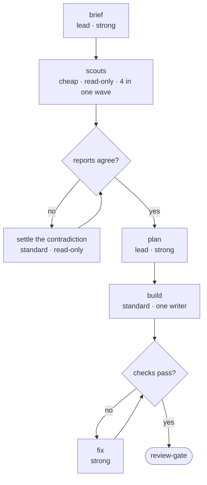

A playbook is where the lead starts, not a contract. Between waves it can skip or repeat a phase,
add one, do a step itself, switch playbooks or go freeform, and you can ask for any of that at any
time. Each change goes into the orchestration's journal with its reason, and the report lists it
under "Changes to the plan".

<p align="center">
  <picture>
    <source media="(prefers-color-scheme: dark)" srcset="./docs/assets/drawings/change-course-dark.svg">
    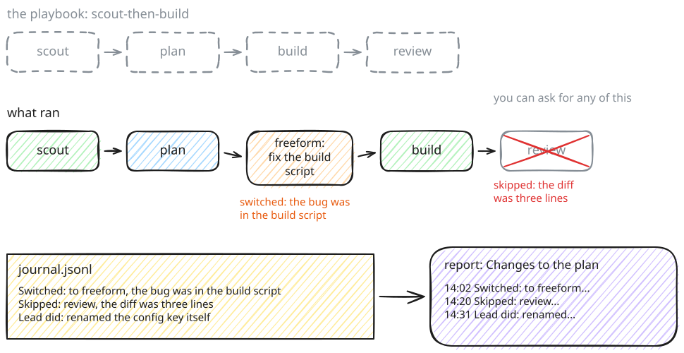
  </picture>
</p>

The playbooks live in one YAML file you can copy and edit with `playbook --init`.
[`references/playbooks.md`](skills/alethe-orchestrate/references/playbooks.md) explains every
field and condition.

## Choosing Providers and Models

Setup takes inventory of the CLIs, models and routes you really have and proposes three profiles
over the same playbooks. Nothing is saved until you approve.

| Profile | Models | Provider order | Switches provider at |
| --- | --- | --- | --- |
| Base | Each CLI's usual model per tier | Your main CLIs first | 80% of a usage window |
| Savings | One step cheaper per tier | Cheapest capable CLI first, scarcest subscription last | 70% |
| Aggressive | One step stronger per tier | Strongest CLIs first | 95% |

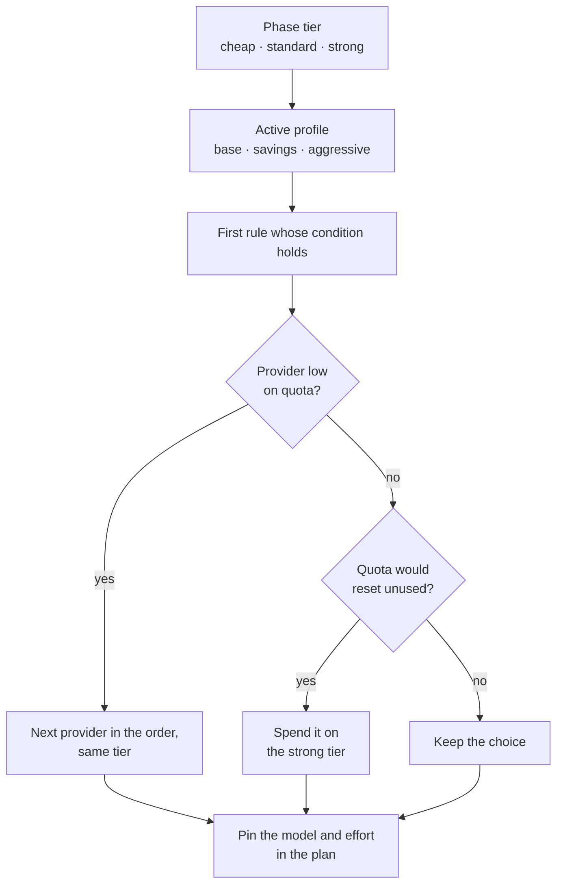

A provider counts as low only when Alethe reported it, you said so, or your policy conserves it;
on its own, the skill never guesses usage it cannot read. Every worker gets its model and effort
pinned, because a worker without them runs on its CLI's default model, which can be the most
expensive one.

## Budgets

| Limit | Set with | Covers | Enforced by |
|---|---|---|---|
| Calls, wall time, prompt size, reported cost, reported tokens | The plan's `budget` | One wave | The runner, before each worker starts |
| Calls, reported cost, reported tokens | `budget [folder]` | Every wave of the orchestration | The runner, adding up the earlier waves |
| Reported cost | Automatic, from the limits above | One Claude worker | Claude Code, through `--max-budget-usd` |
| Defaults for any of the above | `policy set` | Every plan | The runner |

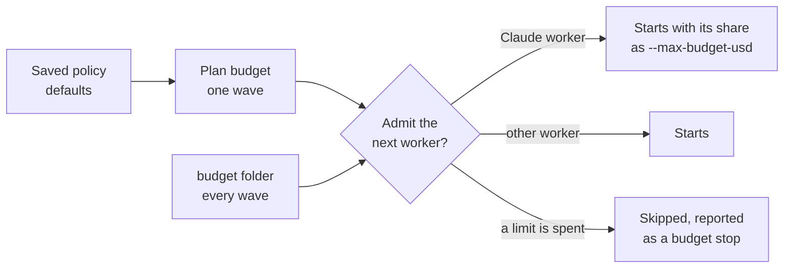

Only Claude reports cost, so `maxReportedTokens` is the limit that covers Codex, Antigravity and the
rest. A limit that cannot see some CLIs shows up as a `dry-run` warning.

## Preview Before You Run

`dry-run --write` saves the resolved plan and `diagram.py` draws it with each provider's official
mark, labelled as a proposal rather than a running session:

<div align="center">
  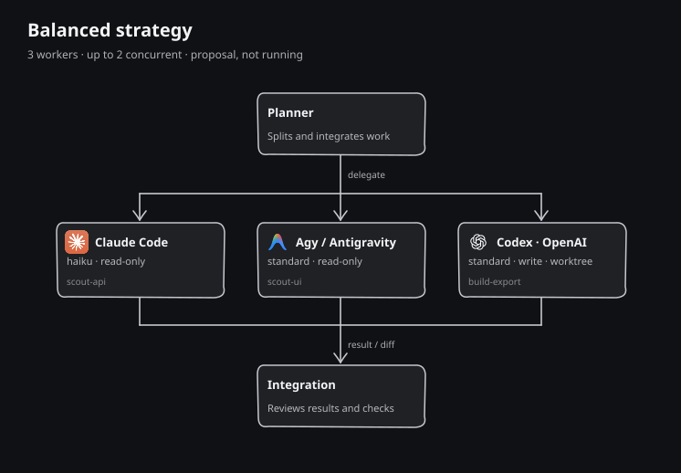
</div>

```sh
python scripts/orchestrate.py dry-run plan.json --write preview.json
python scripts/diagram.py preview.json preview.svg
```

## The Report

```sh
python scripts/orchestrate.py report <orchestration-folder>
```

A real report from a two-worker run, rendered:

> **Orchestration report**
>
> **Check the report on real CLIs**, playbook `research`, 1 wave, 2026-10-18 21:20 to 21:20
>
> - **Result:** 2 of 2 workers succeeded
> - **Time:** 16s running, 29s of worker time
> - **Tokens:** 108,820 reported, 65,836 of them from cache
> - **Cost:** $0.16 reported by claude; codex reports no cost
> - **Lead context:** 5.0 KB of worker transcripts stayed on disk, 595 B of results to read
>
> | Worker | Role | Ran on | Mode | Status | Time | Tokens | Cost |
> | --- | --- | --- | --- | --- | --- | --- | --- |
> | `claude-haiku` | cheapest Claude model for a one-line answer | claude, haiku | read | succeeded | 12s | 76,160 | $0.16 |
> | `codex-low` | default Codex model at low effort | codex, default model, low | read | succeeded | 16s | 32,660 | - |

The report never estimates. Tokens and cost are what each CLI reported; Claude Code reports cost
at API prices, so on a subscription that work counted against your plan's limits instead. It also:

- lists failures with their cause and what to do next, and workers that succeeded but said they
  were blocked, got a failing verdict, wrote while read-only or had tool calls denied;
- adds a **Value** line once results are marked, splitting the spend between what you used,
  partly used and discarded;
- shows budget stops, the orchestration budget, changed files, worktrees to review and sessions
  you can resume.

`--format json` returns the same data, and `status` prints a few lines to pick an orchestration
up again after the conversation was compacted. Both read the current orchestration when no folder
is given, so `/alethe report` is all it takes.

## Install

**Any agent** (Claude Code, Codex, Cursor, Gemini CLI, Antigravity and others):

```sh
npx skills add Kc1t/alethe-orchestrate-skill
```

**Claude Code plugin:**

```text
/plugin marketplace add Kc1t/alethe-orchestrate-skill
/plugin install alethe-orchestrate@alethe
```

**Codex plugin:**

```sh
codex plugin marketplace add Kc1t/alethe-orchestrate-skill
codex plugin add alethe-orchestrate@alethe
```

**By hand:** copy `skills/alethe-orchestrate` into your agent's skills folder, such as
`~/.claude/skills/`, `~/.codex/skills/` or `~/.agents/skills/`.

Then ask your agent to set up orchestration, and after that, ask in plain words: "orchestrate this
refactor", "use savings for now", "what did that run cost?".

Every install adds `/alethe`, a short skill that hands its words to alethe-orchestrate. In an agent without slash commands, write the same words after "alethe".

| Type | It does |
| --- | --- |
| `/alethe <task>` | Orchestrates the task |
| `/alethe on`, `save`, `max`, `careful` | Keeps it on for this project, with that goal or care level |
| `/alethe from now on <instruction>` | Keeps it on and keeps your instruction as a standing rule |
| `/alethe always` | Keeps it on in every project, so you never call it |
| `/alethe off` | Turns it off, in this project only when it is on everywhere |
| `/alethe report` | The full report of the current orchestration |
| `/alethe status` | Where it stands, in a few lines |
| `/alethe list` | Recent orchestrations, with their waves and spend |
| `/alethe stop` | Stops the running workers and skips the queued ones |
| `/alethe skip <phase>`, `switch <playbook>`, `freeform` | Changes course and records why |
| `/alethe budget <limit>` | Caps calls, reported cost or tokens for every wave |
| `/alethe mark <worker> used` | Records what a result was worth |
| `/alethe setup` | Checks the CLIs and walks through the first configuration |

You call it once; see [Call It Once, at Any Point](#call-it-once-at-any-point). With nothing
configured yet, it uses the CLIs it finds for the task at hand and offers the full setup afterwards.

## Commands

All commands live in `skills/alethe-orchestrate/scripts/orchestrate.py`; your agent runs them for
you.

| Stage | Command | What it does |
| --- | --- | --- |
| Setup | `doctor` | Checks Python, the installed CLIs, whether each is logged in, and the saved policy |
| Setup | `playbook` | Prints the playbooks the planner follows; `--init` copies them for editing |
| Setup | `policy show\|set\|reset` | Shows or changes saved preferences |
| Setup | `probe`, `strategies` | Lists the installed CLIs and the runner strategies |
| Plan | `scaffold <strategy>` | Prints a starter plan |
| Plan | `validate <plan>` | Checks a plan without running it |
| Plan | `dry-run <plan>` | Explains the strategy, providers, models and budget, with warnings |
| Setup | `mode on\|off\|show` | Keeps orchestration on for a project, or with `--everywhere` in all of them, with `--goal`, `--care` and `--rule` |
| Run | `new <title>` | Starts an orchestration folder and makes it current |
| Run | `budget [folder]` | Shows or sets limits that cover every wave in an orchestration |
| Run | `run <plan> --in current` | Runs one wave as the next step of the current orchestration |
| Run | `note <text>` | Records a change to the plan: a skipped phase, a switched playbook, a step the lead did |
| Run | `stop [folder]` | Stops the running waves; queued workers are skipped |
| After | `status [folder]` | Prints where an orchestration stands in a few lines |
| After | `mark [folder] <worker> used\|partial\|discarded` | Records whether a result was kept, for the value line |
| After | `report [folder]` | Explains what the runs did, why, what changed in the plan, and what they reported spending |
| After | `list`, `use <folder>` | Lists recent orchestrations; makes one current again |

`scripts/diagram.py` renders a dry-run as an SVG architecture preview.

## Files It Keeps

| What | Where |
| --- | --- |
| Policy | `%APPDATA%\Alethe\alethe-orchestrate.json` on Windows, `~/.config/alethe/orchestrate.json` elsewhere. `ALETHE_ORCHESTRATE_POLICY` overrides it |
| Your playbooks and profiles | `alethe-playbooks.yaml` next to the policy. `ALETHE_ORCHESTRATE_PLAYBOOKS` overrides it |
| Orchestrations | `orchestrations/` next to the policy, one folder per `new`, with a wave folder per run. `ALETHE_ORCHESTRATE_HOME` overrides it |
| Single runs | The temporary directory, or the folder given with `--run-dir` |
| Orchestration limits and plan changes | `budget.json` and `journal.jsonl` in the orchestration folder |
| Modes that are on | `modes.json` in the orchestrations folder, per project |
| Worktrees | `<repo>/.alethe/worktrees/`, kept until you remove them and excluded from `git status` |

An orchestration folder holds one run per wave:

```text
<folder>/
├── budget.json              limits for every wave, optional
├── 01-explore/
│   ├── state.json           the batch at a glance, live while it runs
│   ├── plan.json            the resolved plan, without task text
│   └── workers/<id>/
│       ├── prompt.txt       the brief the worker received
│       ├── result.md        its final answer
│       ├── outcome.json     status, failure kind, metrics, tripwire
│       ├── diff.patch       what a writer changed
│       ├── mark.json        used, partial or discarded, optional
│       └── stdout.log, stderr.log
└── 02-build/
```

## Safety

- Workers start from argument arrays; nothing runs through a shell. On Windows, npm's `.cmd` shims
  are launched through their real target, so cmd.exe never rewrites a prompt.
- Every task carries a contract: no delegation, no commits, pushes, tags or pull requests. Codex
  and Claude workers also cannot start subagents, and no worker can start an orchestration.
- Flags that remove isolation, such as `--dangerously-skip-permissions` or `--trust-all-tools`,
  are refused unless the plan sets `allowUnsafe` after you agree to it.
- Read-only workers in a checkout are checked against git afterwards.
- The parallel strategy gives every writer its own worktree, and the runner never stashes or
  commits your checkout.

## With Alethe

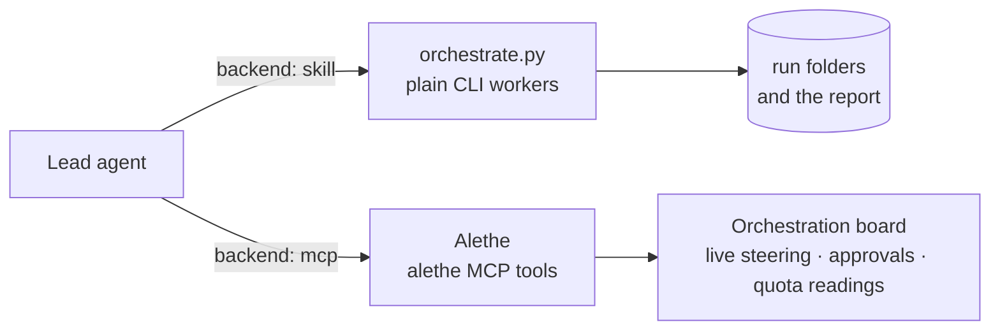

Alethe bundles this skill and installs it for Claude Code and Codex. When Alethe is running, the
skill can use its `alethe_*` MCP tools instead of plain CLI workers, which adds the orchestration
board, live steering, approval dialogs and quota readings. Alethe's Orchestration preferences own
the backend, the default strategy, provider switching and concurrency; budgets and model tiers stay
as you set them here. Without Alethe, everything above still works.

## Development

```sh
python -m unittest discover -s tests
python -m pip install pyyaml && python tools/check_playbooks.py
```

The tests run fake CLIs, so they need no agent installed and spend no quota. CI runs them on
Ubuntu and Windows with Python 3.9 and 3.13, and on macOS with 3.13. Alethe vendors this skill:
change it here, then run `npm run skill:sync -- --from <this checkout>` in the Alethe repository.

## Roadmap

- [x] Playbooks, profiles, quota rules and a setup that builds them from what you have.
- [x] A report that never estimates, with what the spend bought.
- [x] Budgets across waves, a Claude cost cap, subagents off and a read-only tripwire.
- [x] Install as a Claude Code or Codex plugin.
- [ ] Built-in adapters for Cursor, OpenCode and GitHub Copilot CLI.
- [ ] Structured review findings through the CLIs' JSON output schemas.
- [ ] A public release and a listing on skills.sh.

## Watch It in Action

<table>
  <tr>
    <th width="38%">Video</th>
    <th>What you will see</th>
  </tr>
  <tr>
    <td>
      <a href="https://www.youtube.com/watch?v=8jvrucR7QCU&amp;t=54s">
        
      </a>
    </td>
    <td>
      <strong><a href="https://www.youtube.com/watch?v=8jvrucR7QCU&amp;t=54s">Stop Using One AI Agent at a Time: Orchestrate AI Agents</a></strong>
      <br><br>
      A practical introduction to coordinating several AI coding agents, and to the git worktree
      isolation that keeps them out of each other's way.
      <br><br>
      <sub>Kauã Miguel - Dev · Portuguese</sub>
    </td>
  </tr>
</table>

## License

MIT, see [`LICENSE`](LICENSE). The drawings in `docs/assets/drawings/` are Excalidraw files,
editable in [Excalidraw](https://excalidraw.com) or Obsidian. The license does not cover the **Alethe** name and logo, or the
vendor marks in `docs/assets/` and `skills/alethe-orchestrate/assets/brands/`, which belong to
their owners; the skill uses the marks only to label each provider.

## Community

- Bugs and feature requests: <https://github.com/Kc1t/alethe-orchestrate-skill/issues>
- Changelog: [`CHANGELOG.md`](CHANGELOG.md)
- Alethe, the desktop workspace this skill comes from: <https://github.com/Kc1t/alethe-agents>
- Maintainer: [Kc1t](https://github.com/Kc1t)

<p align="right">(<a href="#readme-top">back to top</a>)</p>
